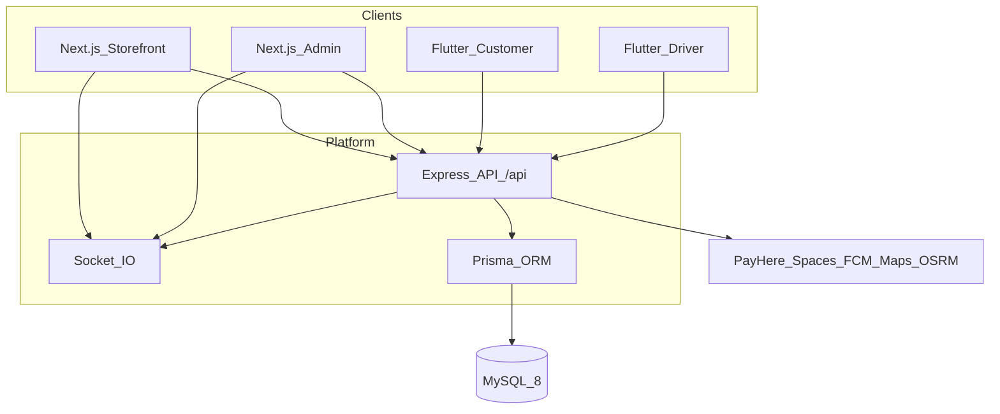

# 01 — Project Overview

## 1. System purpose

**Bing Chun Online** is a multi-channel beverage ordering and branch operations platform for Bing Chun (Sri Lanka). It enables customers to order for **delivery** or **takeaway** via web and mobile, and enables branch staff and system administrators to manage menus, orders, stock, delivery jobs, wallets, commissions, and settlements.

Primary API base path: `/api` (Express). Customer/admin UI: Next.js. Delivery drivers and customers also have Flutter clients.

---

## 2. Business problem

Physical and franchise branches need a unified digital channel to:

- Accept online and in-branch orders with correct branch / delivery-zone assignment
- Coordinate takeaway queues and multi-stop delivery routes
- Track payments (PayHere online, cash on delivery, cash at counter, loyalty)
- Settle branch earnings, withdrawals, and platform commissions
- Enforce role-based access across system admins, branch managers, cashiers, and drivers

Without this system, ordering, routing, and financial reconciliation would be fragmented across manual processes and disconnected tools.

---

## 3. Objectives

| Objective | How the system addresses it |
|-----------|----------------------------|
| Multi-channel ordering | Next.js storefront + Flutter customer app + guest checkout |
| Branch operations | Admin panel: orders, stock, cashiers, takeaway queue |
| Delivery operations | Job clustering, OSRM routing, Flutter driver app |
| Payments | PayHere (live/sandbox/mock), cash methods, loyalty points |
| Branch finance | Store wallets, withdrawals, commission settlements |
| Access control | JWT + RBAC roles + per-menu CRUD permissions |
| Realtime updates | Socket.io for order/user/admin/store rooms |

---

## 4. Target users

| User | Channel | Primary goals |
|------|---------|---------------|
| Customer (guest or registered) | Web, Flutter customer app | Browse menu, order, pay, track, rate |
| Cashier | Web admin | View/update branch orders, limited delivery |
| Store manager (branch admin) | Web admin | Branch orders, stock, wallet request, cashiers |
| System admin | Web admin | Brand reports, all stores, settlements, settings |
| Report viewer | Web admin | Read-oriented analytics (role seeded) |
| Delivery driver | Flutter driver app | Claim jobs, navigate route, mark delivered |

---

## 5. User roles

Seeded admin roles (see `backend/prisma/seed.ts`):

| Role | Code | Typical scope |
|------|------|---------------|
| System admin | `SYSTEM_ADMIN` | Full admin; bypasses permission matrix |
| Store manager | `STORE_MANAGER` | Branch-scoped operations |
| Cashier | `CASHIER` | Orders/delivery; blocked from many finance routes (`blockCashier`) |
| Report viewer | `REPORT_VIEWER` | Reporting-oriented access |
| Delivery driver | `DELIVERY_DRIVER` | Driver JWT via PIN login; `/api/delivery/*` |

Customer accounts use `users` (not `admin_users`) with JWT `type: 'user'`.

---

## 6. Core features

### Implemented

- Customer auth: register, email/password login, phone login, OTP, Google/Facebook token verify, refresh tokens
- Customer account pages: addresses, loyalty summary, notification preferences
- Menu: categories, products, toppings, image upload (DigitalOcean Spaces when configured)
- Stores & delivery zones; delivery validation and address autocomplete/reverse geocode
- Cart (authenticated) and place order (guest or authenticated)
- Order lifecycle, takeaway queue + QR, ratings (platform + rider)
- PayHere checkout page + payment notify / confirm; mock payment when credentials invalid
- Admin dashboard, orders, stock, menu CRUD, promos, stores, staff/permissions
- Delivery classify/cluster, jobs, drivers, route preview
- Store wallets, withdrawals, settle/payout, commission settlements, payment history
- Brand/branch analytics reports (many system-admin-only)
- Customer & admin in-app notifications; FCM push when Firebase service account configured
- Socket.io realtime tracking
- Docker Compose (MySQL + backend + frontend); CapRover deploy via GitLab CI

### Partial

- SMS provider Dialog and Email SendGrid: config exists; production adapters stubbed (default `mock`)
- Admin MFA: **removed** (email + password only; no MFA columns)
- Admin POS page exists; sidebar entry **hidden**
- Customer mobile: referral, help tickets, saved cards, many settings toggles: **client stubs**
- Prisma schema evolution: `db push` + runtime `ensure*Schema` SQL patches (not full Migrate history)

### Not Implemented

- Dedicated repository layer
- Password-reset HTTP API
- Cookie-based session auth as primary mechanism
- NGINX / PM2 configs in repository
- Frontend unit test suite
- CI test stage (build/deploy only)
- Bookings / reservations module

---

## 7. Technologies (summary)

| Layer | Technology |
|-------|------------|
| Backend | Node.js 18+, Express 5, TypeScript, Prisma 5, MySQL 8, Socket.io, Zod, Vitest |
| Web | Next.js 16, React 19, Zustand, TanStack Query, Tailwind 4, Leaflet, Recharts |
| Driver mobile | Flutter, Riverpod, go_router |
| Customer mobile | Flutter, Riverpod, PayHere WebView, Firebase Messaging |
| Deploy | Docker, CapRover, GitLab CI Container Registry |

Full detail: [03_Technology_Stack.md](03_Technology_Stack.md).

---

## 8. High-level architecture

---

## 9. Folder structure explanation

| Path | Responsibility |
|------|----------------|
| `backend/` | Express API, Prisma schema/seed, Vitest, Docker, CapRover deploy |
| `frontend/` | Next.js customer storefront + `/admin` panel |
| `mobile/` | Flutter delivery driver app |
| `customer_mobile/` | Flutter customer ordering app |
| `e2e/` | Playwright end-to-end specs |
| `docs/` | This documentation suite |
| `scripts/` | Helper scripts (e.g. `flutter.cmd`) |
| Root | npm workspaces (`backend`, `frontend`), `docker-compose.yml`, `.github/workflows/ci-cd.yml`, Playwright config |

**Note:** Flutter apps are **not** npm workspaces. Root README packages table documents the driver app; customer Flutter app is present and scripted (`dev:customer`, `build:customer`) but historically under-documented in the root README.

Detailed tree: [04_Project_Structure.md](04_Project_Structure.md).

---

## 10. Related documents

- [02_System_Architecture.md](02_System_Architecture.md)
- [26_Project_Report.md](26_Project_Report.md)
