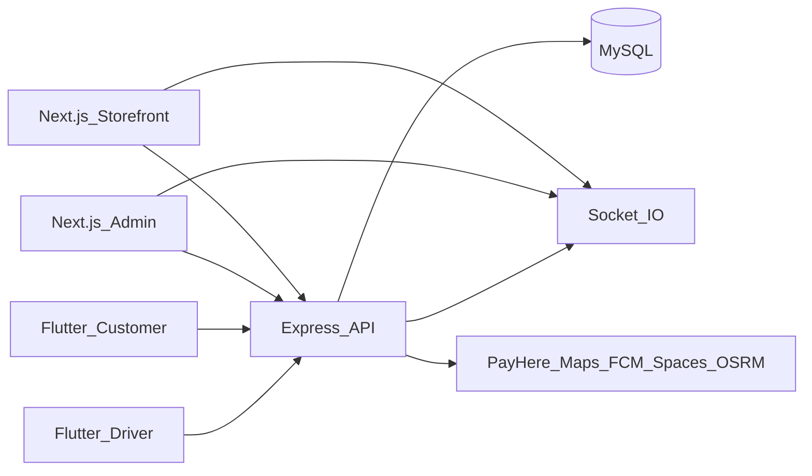
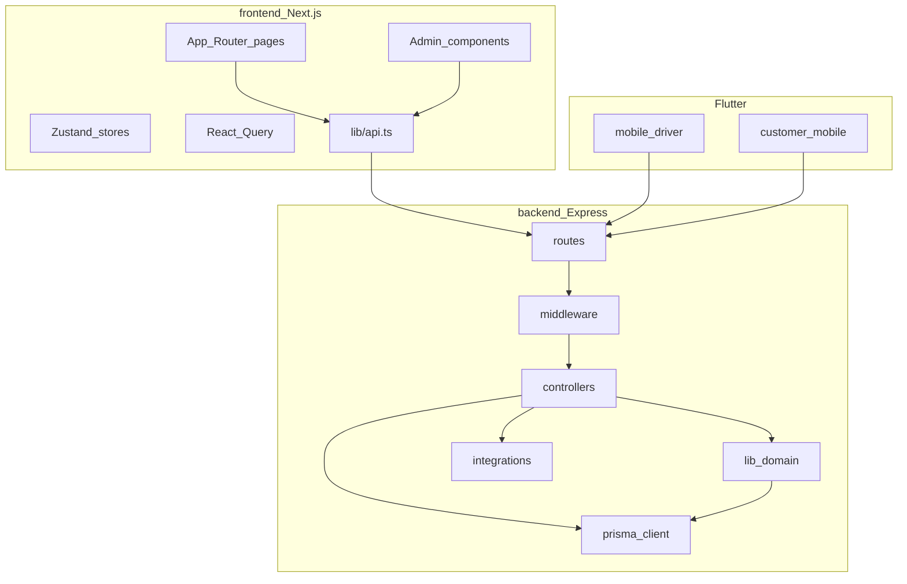
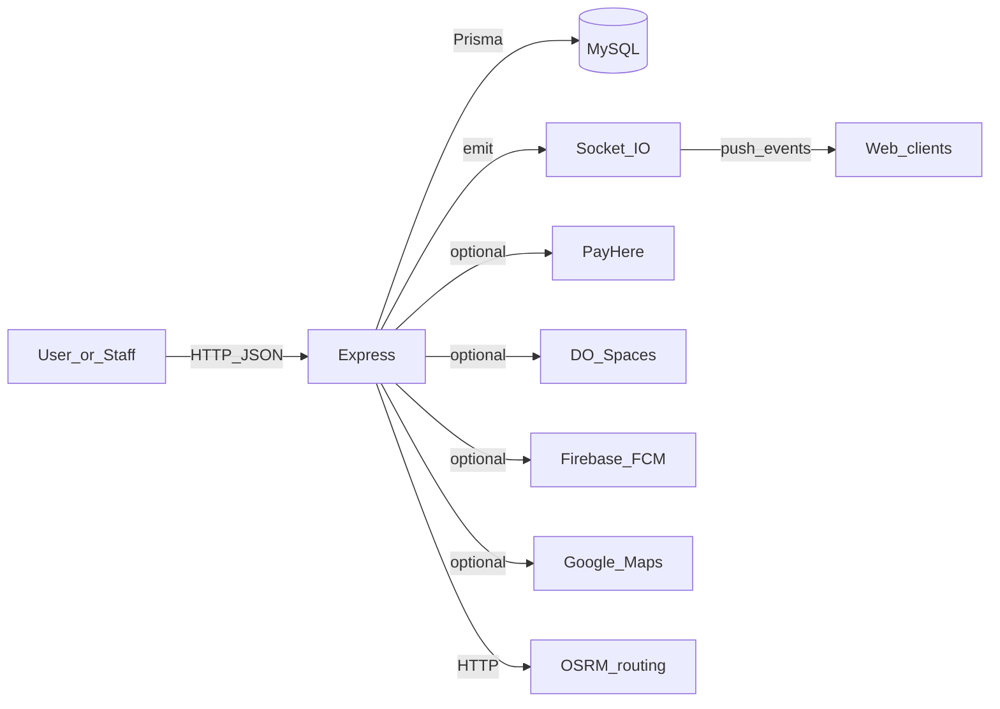
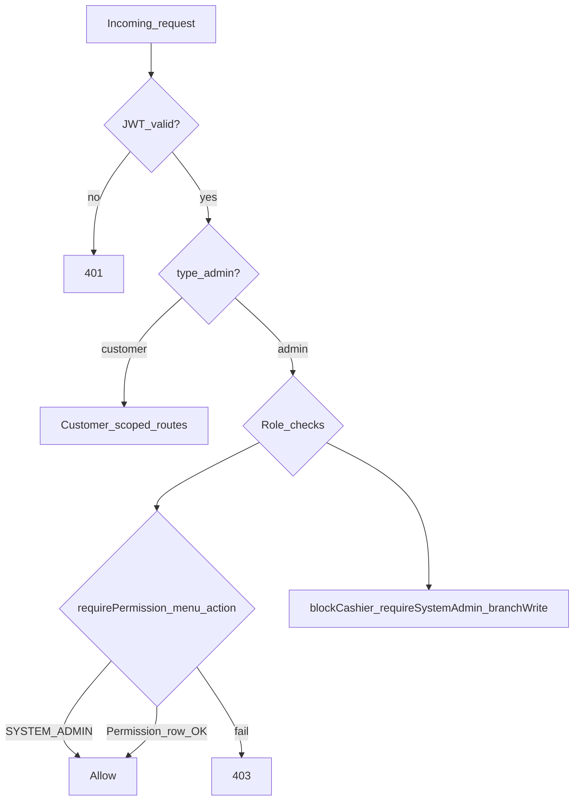

# 02 — System Architecture

## 1. Architecture diagram



---

## 2. Component diagram



**Repositories:** Not Implemented — controllers and `lib/*` call Prisma directly.

---

## 3. Data flow diagram



Money amounts are stored as **integers (LKR cents/rupees as used by app — Int fields on orders/wallets)**.

---

## 4. Request flow

1. Client sends HTTP request to `{API_BASE}/api/...` (or `GET /health`).
2. Global middleware: Helmet, CORS, JSON body, cookie-parser, general rate limiter.
3. Route-specific middleware: auth rate limits, `authenticate` / `optionalAuth`, `requireAdmin`, permissions, uploads.
4. Controller validates with Zod (where used), executes business logic via Prisma/`lib/*`.
5. Response envelope typically `{ data, message }` (see API utils).
6. Errors: Zod → 422; `AppError` → status code; else 500.

---

## 5. Authentication flow

```mermaid
sequenceDiagram
  participant Client
  participant API
  participant DB

  Client->>API: POST /api/auth/login or phone/google/facebook/admin/delivery
  API->>DB: Verify credentials or social token
  API-->>Client: accessToken + refreshToken + user/admin profile
  Client->>API: Bearer accessToken on protected routes
  API->>API: jwt.verify JWT_SECRET
  Note over Client,API: Admin access ~15m refresh ~7d; Customer access no expiry refresh ~3650d
  Client->>API: POST /api/auth/refresh or /auth/admin/refresh
  API-->>Client: New access token
```

Details: [08_Authentication_Authorization.md](08_Authentication_Authorization.md).

---

## 6. Authorization flow



Permission menus include: `DASHBOARD`, `ORDERS`, `MENU`, `STORES`, `PROMOS`, `SETTINGS`, `STOCK`, `DELIVERY`, `SALES`, `WALLET`, `PAYMENT_HISTORY`, `REPORTS`, `USERS`, `BRANCH_MANAGERS`, `CASHIERS`, and related keys used in routes.

---

## 7. API flow

| Mount | Module |
|-------|--------|
| `/api/auth` | Customer, admin, delivery auth |
| `/api/menu` | Categories, products, toppings |
| `/api/stores` | Stores, zones, geocode helpers |
| `/api/cart` | Authenticated cart |
| `/api/orders` | Place, track, admin order ops, PayHere notify |
| `/api/addresses` | Customer addresses |
| `/api/promos` | Public validate + admin CRUD |
| `/api/loyalty` | Customer loyalty summary |
| `/api/settings` | Payment methods, app settings, zones |
| `/api/payments` | PayHere HTML checkout |
| `/api/notifications` | Customer notifications + FCM token |
| `/api/delivery` | Driver job APIs |
| `/api/admin` | Dashboard, wallet, reports, staff, stock, delivery ops |

Full catalog: [06_API_Documentation.md](06_API_Documentation.md).

---

## 8. Database flow

1. Boot: Prisma client connects via `DATABASE_URL`.
2. Runtime schema patches: multiple `ensure*Schema` helpers alter/create tables if missing.
3. Dev/ops: `prisma db push`, optional SQL files under `prisma/migrations/`, `prisma db seed`.
4. Controllers/lib issue CRUD through `@prisma/client`.

**Formal Prisma Migrate history with lockfile:** Partial / not the primary workflow (SQL patches + push + ensure*).

---

## 9. Frontend flow

1. Next.js App Router pages (mostly `'use client'`).
2. Customer: Zustand (`authStore`, `cartStore`) + React Query + `lib/api.ts` Bearer from `bc_token`.
3. Admin: localStorage `bc_admin_token` / refresh; per-page `adminFetch`; session idle guard (~15m).
4. Socket providers join user/order/admin rooms for live updates.
5. **Next.js `middleware.ts`:** Not Implemented — guards are client-side.

Flutter customer polls order status (no Socket.io client). Driver app uses REST only.

---

## 10. External services and third-party APIs

| Service | Status | Usage |
|---------|--------|-------|
| PayHere | Implemented (mock fallback) | Online payment initiate, MD5 notify, checkout page |
| DigitalOcean Spaces | Implemented when configured | Product / settlement uploads via S3 SDK |
| Firebase Admin / FCM | Implemented when JSON set | Push notifications |
| Google Maps API | Implemented if key set; else mock | Autocomplete / reverse geocode |
| Google OAuth | Implemented | ID token verify (`GOOGLE_CLIENT_ID`) |
| Facebook Login | Implemented | Access token verify |
| OSRM | Implemented | Road geometry (default public OSRM URL) |
| Dialog SMS | Not Implemented | Stub throws if `SMS_PROVIDER=dialog`; default mock |
| SendGrid Email | Not Implemented | Stub throws if `EMAIL_PROVIDER=sendgrid`; default mock |
| `FCM_SERVER_KEY` | Unused | Config only; FCM uses service account JSON |

---

## Related

- [25_Architecture_Diagrams.md](25_Architecture_Diagrams.md)
- [35_Shop_Pos_Admin_Architecture.md](35_Shop_Pos_Admin_Architecture.md) — shop, cashier, and admin as separate processes
- [10_Backend_Documentation.md](10_Backend_Documentation.md)
- [09_Frontend_Documentation.md](09_Frontend_Documentation.md)
