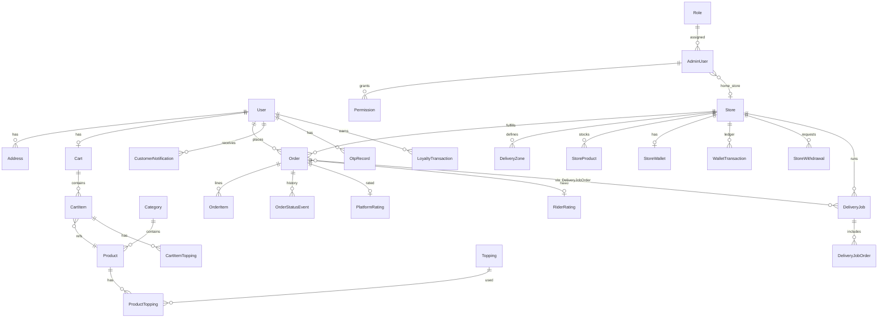

# 05 — Database Documentation

**ORM:** Prisma 5 → MySQL 8  
**Schema file:** [`backend/prisma/schema.prisma`](../backend/prisma/schema.prisma)

**Migration approach:** Ad-hoc SQL under `backend/prisma/migrations/` + `prisma db push` + runtime `ensure*Schema` helpers. Full Prisma Migrate history with `migration_lock.toml` is **not** the primary workflow.

**Runtime-only table (not in Prisma schema):** `customer_fcm_tokens` — created via raw SQL in FCM token controller.

---

## 1. ER diagram (core)

---

## 2. Enums

| Enum | Values |
|------|--------|
| `OrderMode` | `DELIVERY`, `TAKEAWAY` |
| `OrderStatus` | `RECEIVED`, `PREPARING`, `READY`, `OUT_FOR_DELIVERY`, `DELIVERED`, `CANCELLED` |
| `PaymentMethod` | `CARD`, `PAYHERE`, `CASH_ON_DELIVERY`, `CASH_AT_COUNTER`, `LOYALTY_POINTS` |
| `PaymentStatus` | `PENDING`, `PAID`, `FAILED`, `REFUNDED` |
| `DeliveryJobStatus` | `SCHEDULED`, `ASSIGNED`, `QUEUED`, `IN_PROGRESS`, `RETURNING`, `COMPLETED`, `CANCELLED` |
| `NotificationType` | `SMS`, `EMAIL`, `PUSH` |
| `ProductSize` | `REGULAR`, `LARGE` |
| `WalletTransactionType` | `ORDER_PAYMENT`, `ORDER_ADDON_PAYMENT`, `REFUND`, `PAYOUT`, `ADJUSTMENT` |
| `SettlementStatus` | `PENDING_VERIFICATION`, `VERIFIED`, `REJECTED` |
| `SettlementPaymentMethod` | `BANK_TRANSFER`, `CASH`, `CHECK`, `ONLINE` |
| `WithdrawalStatus` | `PENDING`, `APPROVED`, `REJECTED`, `CANCELLED` |

---

## 3. Tables

### `roles`

| Field | Type | Constraints |
|-------|------|-------------|
| id | String (uuid) | PK |
| name | String | UNIQUE |

Relations: `AdminUser[]`

---

### `users`

| Field | Type | Notes |
|-------|------|-------|
| id | String uuid | PK |
| name | String | |
| email | String? | UNIQUE |
| phone | String | UNIQUE |
| passwordHash | String? | |
| googleId / facebookId | String? | UNIQUE |
| isEmailVerified | Boolean | default false |
| isPhoneVerified | Boolean | default true |
| loyaltyPoints | Int | default 0 |
| notifyEmail / notifySms / notifyPush | Boolean | defaults true |
| createdAt / updatedAt | DateTime | |
| deletedAt | DateTime? | soft delete |

---

### `customer_notifications`

| Field | Type | Notes |
|-------|------|-------|
| id | String uuid | PK |
| userId | String | FK → users, Cascade |
| type | String | default `ORDER_STATUS` |
| title | String | |
| message | Text | |
| orderId / orderNumber / status | optional | |
| read | Boolean | default false |
| createdAt | DateTime | |

Indexes: `(userId, read)`, `(userId, createdAt)`

---

### `otp_records`

| Field | Type | Notes |
|-------|------|-------|
| id | String uuid | PK |
| userId | String | FK → users |
| phone | String | |
| code | String | |
| attempts | Int | default 0 |
| expiresAt | DateTime | |
| used | Boolean | default false |
| createdAt | DateTime | |

---

### `addresses`

| Field | Type | Notes |
|-------|------|-------|
| id | String uuid | PK |
| userId | String | FK Cascade |
| label | String | default `Home` |
| addressLine, city, district | String | |
| lat / lng | Float? | |
| isDefault | Boolean | |
| createdAt | DateTime | |

---

### `stores`

| Field | Type | Notes |
|-------|------|-------|
| id | String uuid | PK |
| name, addressLine, city, district | String | |
| lat, lng | Float | required |
| phone | String? | |
| openTime / closeTime | String | defaults 09:00 / 23:00 |
| isActive / isBusy | Boolean | |
| deliveryEnabled | Boolean | default false |
| createdAt / updatedAt | DateTime | |

---

### `delivery_zones`

| Field | Type | Notes |
|-------|------|-------|
| id | String uuid | PK |
| storeId | String? | FK Cascade nullable (global zones) |
| name | String | |
| radiusKm | Float | |
| fee | Int | |
| minOrder | Int | default 500 |
| isActive / isGlobal | Boolean | |

---

### `categories`

| Field | Type | Notes |
|-------|------|-------|
| id | String uuid | PK |
| name / slug | String | UNIQUE each |
| icon | String? | |
| sortOrder | Int | |
| isActive | Boolean | |

---

### `products`

| Field | Type | Notes |
|-------|------|-------|
| id | String uuid | PK |
| categoryId | String | FK → categories |
| name | String | |
| slug | String | UNIQUE |
| description | Text? | |
| basePrice | Int | Selling price (LKR) |
| cost | Int | Unit cost (LKR), default 0; super-admin only |
| imageUrl / tag | String? | |
| isAvailable / isDeliveryAvailable | Boolean | |
| isCombo | Boolean | |
| sortOrder | Int | |
| createdAt / updatedAt | DateTime | |

---

### `store_products`

| Field | Type | Notes |
|-------|------|-------|
| storeId | String | PK composite |
| productId | String | PK composite |
| stock | Int | default 50 |
| isAvailable | Boolean | |
| updatedAt | DateTime | |

FK Cascade to store and product.

---

### `toppings` / `product_toppings`

**toppings:** id, name UNIQUE, extraPrice Int, isAvailable  
**product_toppings:** composite PK `(productId, toppingId)`

---

### `carts` / `cart_items` / `cart_item_toppings`

**carts:** id, userId UNIQUE, orderMode, storeId?, updatedAt  
**cart_items:** id, cartId, productId, size, quantity, unitPrice  
**cart_item_toppings:** composite PK `(cartItemId, toppingId)`

---

### `orders`

| Field | Type | Notes |
|-------|------|-------|
| id | String uuid | PK |
| orderNumber | String | UNIQUE |
| userId | String? | FK |
| guestName / guestPhone / guestEmail | String? | guest checkout |
| storeId | String | FK required |
| deliveryZoneId / addressId | String? | FKs |
| orderMode | OrderMode | |
| status | OrderStatus | default **RECEIVED** |
| paymentMethod / paymentStatus | enums | |
| paymentRef | String? | |
| subtotal, deliveryFee, convenientFee, discount, loyaltyDiscount, total, prepaidAmount | Int | |
| cashReceivedAmount / changeGivenAmount | Int? | Cash tender / change at counter or COD |
| promoCode | String? | |
| qrCode | Text? | |
| pickupTime / queuePosition / scheduledPickupAt / pickupReminderSent | takeaway fields | |
| estimatedMinutes | Int | default 30 |
| notes | Text? | |
| deliveryAddressLine/City/District/Lat/Lng | snapshot | |
| platform | Int | default 0 |
| createdAt / updatedAt | DateTime | |

---

### `platform_ratings` / `rider_ratings`

Both: one-per-order (`orderId` UNIQUE), stars Int, comment optional.  
Rider rating requires `driverId` → `admin_users`.

Indexes: platform on `createdAt`, `stars`; rider on `driverId`.

---

### `order_items` / `order_item_toppings` / `order_status_events`

Line items snapshot productName/prices; toppings snapshot name/extraPrice; status events append-only history.

---

### `promo_codes`

id, code UNIQUE, description?, discountType (string, default PERCENTAGE), discountValue, minOrderValue, maxUses?, usedCount, isActive, expiresAt?, createdAt

---

### `loyalty_transactions`

id, userId FK, orderId?, points, type, note?, createdAt

---

### `notifications`

Outbound notification log: userId?, phone?, email?, type NotificationType, subject?, message, sent, sentAt?, createdAt

---

### `admin_users`

| Field | Type | Notes |
|-------|------|-------|
| id | String uuid | PK |
| name / email | String | email UNIQUE |
| passwordHash | String | |
| pinLookup | String? | driver PIN lookup |
| roleId | String | FK → roles |
| storeId | String? | FK home store |
| isActive | Boolean | |
| lastLoginAt | DateTime? | |
| createdAt / updatedAt | DateTime | |

UNIQUE `(storeId, pinLookup)`. M2M accessible stores via join relation `AdminUserAccessibleStores`.

---

### `permissions`

id, adminUserId FK Cascade, menu String, canCreate/Read/Update/Delete Booleans  
UNIQUE `(adminUserId, menu)`

---

### `delivery_jobs` / `delivery_job_orders`

Jobs: storeId, driverId?, title, **rideCode** (`RIDE-####`), status (includes **RETURNING**), schedule/assign/start/**returnStartedAt**/complete timestamps, **totalCups**, **estimatedDistanceKm**, **estimatedMinutes**, totalDistanceKm (mirrors estimate), totalDeliveryFees, **actualDistanceKm**, **actualRoute** (JSON polyline), **completedLat/Lng**, rider rating aggregates.  
Job orders: composite PK `(jobId, orderId)`, sequence Int.

Indexes on jobs: `(storeId, status)`, `(driverId, status)`, `(status, completedAt)`; unique on `rideCode`.

Stores may set **completionRadiusM**; `app_settings.branchCompletionRadiusM` (default 100) is the fallback geofence for completing a ride at the branch.

---

### `admin_notifications`

id, adminUserId, storeId, type, title, message, orderId?, read, createdAt  
Indexes: `(adminUserId, read)`, `(storeId, createdAt)`

---

### Singleton settings tables

| Table | PK | Purpose |
|-------|-----|---------|
| `system_settings` | id=`default` | paymentMethods JSON, PayHere credentials, mode |
| `loyalty_settings` | id=`default` | pointsPerLkr, redeemValue, maxRedeemPct, minOrderToEarn |
| `app_settings` | id=`default` | convenientFeeRate, pickup edit flags, maxCupsPerRider, delivery milestones, **branchCompletionRadiusM** |

---

### `store_wallets`

id, storeId UNIQUE, balance, totalEarnings, totalWithdrawn, currency default LKR, lastSettledAt?, timestamps

---

### `store_withdrawals`

Withdrawal request with status, period, payment proof fields, invoice, breakdown JSON, isAdvance, requestedById, reviewed*, walletTransactionId UNIQUE optional.

**Breakdown snapshot** (JSON) includes period commission/gateway totals plus SPPC fields when applicable:

| Key | Description |
|-----|-------------|
| `sharedPromoTotalDiscount` | Total SHARED promo discount in period (cents) |
| `sharedPromoBranchContributionPct` | Blended branch % |
| `sharedPromoBranchContributionAmount` | Branch share (cents) |
| `sharedPromoPlatformContributionPct` | Blended platform % |
| `sharedPromoPlatformContributionAmount` | Platform share deducted from Jason at approval (cents) |
| `finalPayoutAmount` | `withdrawal.amount + sharedPromoPlatformContributionAmount` |

Indexes: `(storeId, createdAt)`, `(storeId, status)`

---

### `jason_ledger_entries`

Owner-level investment/expense ledger (Jason admin page). Separate from store wallets.

| Column | Notes |
|--------|-------|
| type | `INVESTMENT` \| `EXPENSE` |
| amount | Cents |
| description | Text |
| occurredAt | Date |
| isActive | Soft-disable; excluded from net totals when false |
| storeId | Optional — branch for auto-generated SPPC expenses |
| storeWithdrawalId | Optional — linked payout request |
| balanceBefore / balanceAfter | Optional — Jason net balance before/after SPPC deduction (cents) |

---

### `wallet_transactions`

Ledger lines: type, amount, balanceAfter, optional orderId, paymentMethod/ref, description, reference, createdById, settledAt, periodFrom/To.  
UNIQUE `(orderId, type)` map `wallet_tx_order_type`. Indexes on store+createdAt, type.

---

### `commission_settlements`

statementRef UNIQUE, store period, status, paymentMethod, receiptUrl, breakdown JSON, totals, verification fields, optional storeWithdrawalId UNIQUE, invoice fields.

Index: `(storeId, periodFrom, periodTo)`

---

### `delivery_access_logs`

Audit when delivery access changes: storeId, action, changedBy*, reason, ordersAtChange, createdAt. Index `(storeId, createdAt)`.

---

### `customer_fcm_tokens` (runtime SQL)

Not in Prisma schema. Created by FCM controller for push token registration (`userId`, `token`, …). Treat as **Partial** relative to schema docs.

---

## 4. Seed data (high level)

From `prisma/seed.ts` (summary):

- Categories, products, toppings
- ~32 Sri Lanka stores + delivery zones
- Promos e.g. `WELCOME10`, `BINGCHUN50`
- Demo customer
- Roles: SYSTEM_ADMIN, STORE_MANAGER, CASHIER, REPORT_VIEWER, DELIVERY_DRIVER
- Demo admins / cashier / driver
- Store inventory sync

---

## Related

- [07_Business_Logic.md](07_Business_Logic.md)
- [06_API_Documentation.md](06_API_Documentation.md)
