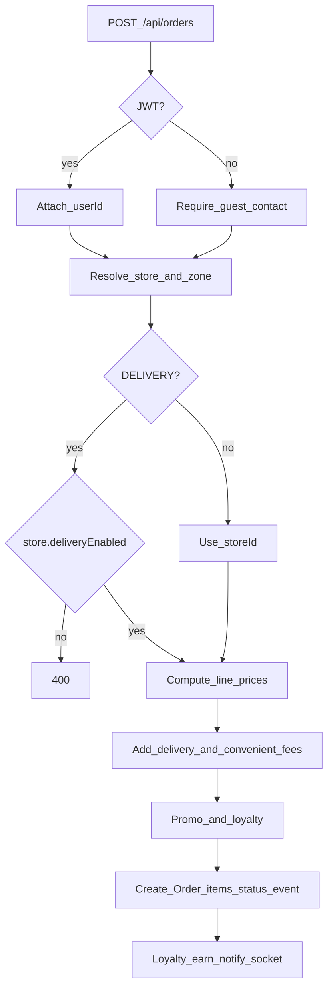
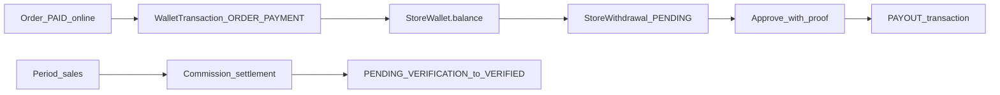

# 07 — Business Logic

## 1. Module map

| Module | Primary code | Responsibility |
|--------|--------------|----------------|
| Pricing | `lib/pricing.ts` | Unit price = base + LARGE(+100) + topping extras |
| Order status | `lib/orderStatus.ts` | Forward-only status machine by mode |
| Order payment | `lib/orderPayment.ts` | Payment rules / mark paid |
| Takeaway queue | `lib/takeawayQueue.ts` | Slots, reorder, pickup reminders |
| Delivery zones | `lib/deliveryZones.ts`, store resolver | Fee + branch selection |
| Clustering / routing | `orderClustering`, `routeOptimizer`, `roadRouting` | Batch jobs + OSRM |
| Wallet / withdrawal | `walletService`, `withdrawalService`, `walletSync` | Earnings & payouts |
| Commission | `lib/commission.ts` | Slabs, provider fees, channel breakdown |
| Notifications | customer/branch libs + FCM | In-app + push |
| Delivery milestones | `deliveryAccessMilestones.ts` | Enable delivery by order counts |
| Stock | `storeInventory` | Per-branch availability |

**Bookings module:** Not Implemented.

---

## 2. Order placement workflow



**Rules:**

- Initial status: **RECEIVED** (`INITIAL_ORDER_STATUS` in `lib/orderStatus.ts`).
- Guest checkout allowed via `optionalAuth`.
- Delivery requires zone resolution and `deliveryEnabled` on store.
- Payment methods gated by `SystemSetting.paymentMethods` and order mode.
- Online methods typically start `PENDING`; some cash paths may start `PAID` per payment helpers.
- Collect payment may record `cashReceivedAmount` / `changeGivenAmount` on the order when cash tender is captured.

---

## 3. Pricing calculations

### Line unit price (`computeUnitPrice`)

```
unitPrice = product.basePrice
if size == LARGE: unitPrice += 100
unitPrice += sum(topping.extraPrice)
```

Product must exist and `isAvailable`.

### Order totals (conceptual)

```
subtotal = sum(unitPrice * quantity)  // toppings included in unit
deliveryFee = zone fee (DELIVERY) or 0
convenientFee = rate * eligible online amount (from AppSetting.convenientFeeRate, default 0.065)
discount = promo discount
loyaltyDiscount = redeemed points value
total = subtotal + deliveryFee + convenientFee - discount - loyaltyDiscount
```

Exact fee application and promo math live in order controller + settings; amounts stored as **Int**.

### Loyalty settings

From `LoyaltySetting` (and env defaults in config):

| Setting | Default (schema) |
|---------|------------------|
| pointsPerLkr | 0.1 |
| redeemValue | 1.0 |
| maxRedeemPct | 20 |
| minOrderToEarn | 200 |

---

## 4. Promo validation

`PromoCode` rules typically enforce:

- Active flag and optional expiry
- `minOrderValue`
- `maxUses` vs `usedCount`
- Discount type string (default `PERCENTAGE`) + `discountValue`

Admin CRUD under `/api/promos/admin*`.

---

## 5. Payment workflows

| Method | Flow |
|--------|------|
| PAYHERE | Checkout page `/api/payments/payhere/:orderNumber` → PayHere → `payment-notify` (hash) and/or `confirm-payment` |
| Mock PayHere | When merchant credentials invalid — frontend `/mock-payment` posts notify |
| CASH_ON_DELIVERY / CASH_AT_COUNTER | Branch `collect-payment` as needed |
| LOYALTY_POINTS | Points redemption against order |

Wallet credit occurs when online payment is confirmed paid (`ORDER_PAYMENT` / addon types).

---

## 6. Order status machine

### Delivery flow

`RECEIVED → PREPARING → READY → OUT_FOR_DELIVERY → DELIVERED`  
(+ `CANCELLED` when allowed)

### Takeaway flow

`RECEIVED → PREPARING → READY → DELIVERED`  
(no `OUT_FOR_DELIVERY`)

**Rules (`assertValidStatusTransition`):**

- Cannot change completed (`DELIVERED` / `CANCELLED`)
- Cannot revert to earlier status
- Cancel allowed from non-terminal states
- Branch order writes restricted to `STORE_MANAGER` / `CASHIER` (`requireBranchOrderWrite`) — system admin cannot mutate branch order status via that guard

---

## 7. Takeaway queue

- 15-minute style slots / queue positions (see `takeawayQueue.ts`)
- QR / track URL generated for customer
- Admin reorder endpoint
- Background reminders (~5 minutes before pickup) via interval processor in server boot

App settings:

- `pickupAllowAddItemsPaidOnline`
- `pickupAllowEditCashUnpaid`

---

## 8. Delivery jobs

1. Admin lists pending ready delivery orders.
2. Classify/cluster by direction and `maxCupsPerRider` (app setting, default 20).
3. Create `DeliveryJob` with ordered stops.
4. Driver assigns → starts (orders → `OUT_FOR_DELIVERY`) → per-order status → completes job.
5. Route: nearest-neighbor optimize + OSRM road geometry (`OSRM_URL`, default public OSRM).

---

## 9. Wallet, commission, withdrawals



- Commission slabs and provider fees: `lib/commission.ts`
- Settlements can include receipt upload (multipart)
- Withdrawal reject: system admin

Delivery partner payouts (`delivery_payouts`) use **completed 30-day** windows only (branch payouts stay on the 15-day cadence). Gross is **PAID** delivery fees only. Platform fee applies to all gross; payment-gateway fee (1.9%) applies only to **CARD/PAYHERE**. Platform, gateway, and net are stored and shown as the exact rate results (not rounded to whole rupees). `amount` / `amountLkr` are **LKR**, not cents. Super Admin pays directly from **Wallet → Payouts Due → Delivery** (`GET /admin/delivery-wallet/payouts-due`, `POST /admin/delivery-wallet/payouts` with proof, payment method, and admin PIN). The period net and branch breakdown are stored in `breakdown` at pay time; overlapping APPROVED periods are rejected (409). Only the oldest due period is payable at once.

The Delivery Wallet **live** range is fees from the day after the last **APPROVED** payout through **today** (`liveFrom` / `liveTo` on payout-preview; civil days are **Asia/Colombo**). Today is included in live net but is not payable. Due periods end on or before yesterday. `GET /admin/delivery-wallet/payout-preview` also returns **`currentPayoutCycle`** (`from`, `through` = today, `cycleTo` = close of the in-progress 30-day window), walking forward from the payout anchor so unpaid elapsed cycles do not block identifying the open cycle. `GET /admin/delivery-wallet` without dates uses the live window; all-time (`scope=all`) is **SYSTEM_ADMIN** only. Delivery Admin has **read-only** `DELIVERY_WALLET` (wallet view and payout history).
- Sync/backfill scripts available under `src/scripts/`

### 9.1 Shared promotion platform contribution (SPPC)

For **SHARED** ownership promotions, discount cost is split between branch and platform (`promotionUsage.ts`). At payout request time:

1. Sum all `PromotionUsage` rows where `ownership = SHARED` for paid, non-cancelled orders in the payout period.
2. Store in `StoreWithdrawal.breakdown` snapshot (cents):
   - `sharedPromoTotalDiscount`, `sharedPromoBranchContributionPct/Amount`, `sharedPromoPlatformContributionPct/Amount`
   - `finalPayoutAmount = withdrawal.amount + sharedPromoPlatformContributionAmount`
3. `StoreWithdrawal.amount` remains the branch wallet debit only; Jason's contribution is additive.

At **approval** (Super Admin):

1. **Jason balance guard** — if `sharedPromoPlatformContributionAmount > 0` and Jason net balance is insufficient, the entire approval is blocked (wallet not debited).
2. `StoreWallet` debited by `withdrawal.amount`; `WalletTransaction.amount` records `-finalPayoutAmount` (payment history & invoice use this).
3. Auto-create `JasonLedgerEntry` EXPENSE with `storeId`, `storeWithdrawalId`, `balanceBefore`, `balanceAfter`.

**Example:** Jason invests LKR 10,000. Branch A shared promo platform share LKR 800 → `finalPayoutAmount` includes +800; on approve Jason balance becomes LKR 9,200.

Implementation: `sharedPromoContribution.ts`, `jasonBalance.ts`, `withdrawalService.ts`.

---

## 10. Delivery access milestones

`AppSetting` defaults:

| Milestone | Default order count |
|-----------|---------------------|
| 1 | 50 |
| 2 | 150 |
| 3 | 300 |

System admin toggles `store.deliveryEnabled`; changes logged in `delivery_access_logs`.

---

## 11. Stock

Per-store `store_products` with `stock` and `isAvailable`.  
Admin list/update/sync endpoints under `/api/admin/stock*`.

---

## 12. Ratings

- Platform rating: one per order
- Rider rating: one per order, linked to driver `AdminUser`

---

## Related

- [05_Database_Documentation.md](05_Database_Documentation.md)
- [06_API_Documentation.md](06_API_Documentation.md)
