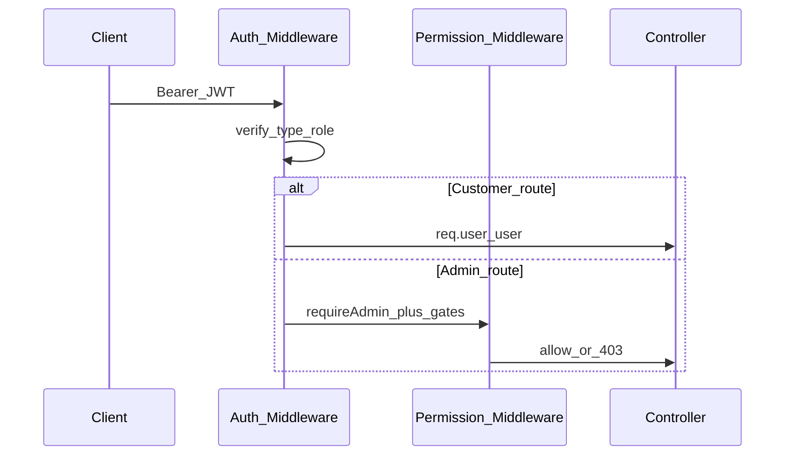

# 08 — Authentication & Authorization

## 1. Overview

| Actor | Mechanism | Token type |
|-------|-----------|------------|
| Customer | Password, phone login, OTP, Google/Facebook | JWT `type: 'user'` |
| Admin / cashier / manager | Email + password | JWT `type: 'admin'` + role + storeId |
| Driver | PIN (+ optional storeId) | JWT admin payload with role `DELIVERY_DRIVER` |

**Primary transport:** `Authorization: Bearer <token>`  
**Cookie session auth as primary:** Not Implemented  
**OAuth redirect server flow:** Not Implemented (token verification only)  
**Admin MFA challenge:** Not Implemented (schema fields only)  
**Password reset HTTP API:** Not Implemented

---

## 2. Login flows

### Customer register / password login

1. `POST /api/auth/register` or `/login`
2. Password hashed with **bcrypt cost 12**
3. Access + refresh JWTs issued

### Phone login (interim)

`POST /api/auth/phone/login` — finds or creates user by normalized Sri Lankan phone **without OTP**. Used by web UI for rapid sign-in.

### OTP

1. `POST /api/auth/otp/request` — rate limited; stores `OtpRecord`
2. SMS via mock provider by default (Dialog **Not Implemented**)
3. `POST /api/auth/otp/verify` — 6-digit code

### Google / Facebook

`socialAuthService` verifies Google ID token / Facebook access token, find-or-create `User` (may use synthetic phone prefixes), issues JWTs.

### Admin login

`POST /api/auth/admin/login` — email/password; rejects `DELIVERY_DRIVER` accounts; branch roles require `storeId`.

### Driver login

`POST /api/auth/delivery/login` — PIN 4–6 digits via `pinLookup` (+ optional store).

---

## 3. JWT

| Setting | Value |
|---------|--------|
| Access secret | `JWT_SECRET` |
| Refresh secret | `JWT_REFRESH_SECRET` |
| Admin access TTL | `15m` (`JWT_EXPIRES_IN` / `config.jwtExpiresIn`) |
| Customer access TTL | **No expiry** — `signToken` for `type=user` omits `expiresIn` (shoppers stay signed in). `JWT_USER_EXPIRES_IN` / `config.jwtUserExpiresIn` (default `3650d`) exists in config but is **not applied** by current signing |
| Admin refresh TTL | `7d` (`JWT_REFRESH_EXPIRES_IN`) |
| Customer refresh TTL | `3650d` (`JWT_USER_REFRESH_EXPIRES_IN`) |
| Driver access | `7d` via `signDeliveryToken` |

**Payload shape (conceptual):** `{ sub, type: 'user' \| 'admin', role?, storeId? }`

Refresh endpoints:

- Customer: `POST /api/auth/refresh`
- Admin: `POST /api/auth/admin/refresh`

Frontend admin refreshes when token nears expiry; idle logout ~15 minutes (`useAdminSessionGuard`).

---

## 4. Soft delete / reactivation

Customers set `deletedAt` on `DELETE /api/auth/me`. Login/phone flows can reactivate deleted users (`userAccount` helpers).

---

## 5. RBAC roles

| Role | Typical access |
|------|----------------|
| `SYSTEM_ADMIN` | Bypasses permission matrix; brand reports; settlements |
| `STORE_MANAGER` | Branch-scoped ops; can manage cashiers |
| `CASHIER` | Orders/delivery; blocked from many finance routes |
| `DELIVERY_ADMIN` | HQ-wide delivery ops across all branches; no linked store; can onboard drivers; delivery wallet |
| `REPORT_VIEWER` | Reporting-oriented |
| `DELIVERY_DRIVER` | Driver app only for delivery APIs |

Branch scoping: managers/cashiers limited to linked store (resolved from DB for sensitive ops).

**All-branch roles** (`isAllBranchRole`): `SYSTEM_ADMIN` and `DELIVERY_ADMIN` have no linked store and may omit `storeId` to query every branch — they pick a branch through a filter instead. `DELIVERY_ADMIN` is deliberately *not* in `BRANCH_SCOPED_ROLES`, so `requireBranchOrderWrite` blocks it from order mutations, exactly as it blocks `SYSTEM_ADMIN`.

Staff accounts are created at `POST /api/admin/users` (`USERS:create`), which assigns the role and seeds that role's default permission matrix from `backend/src/constants/defaultPermissions.ts`. `DELIVERY_ADMIN` defaults to `DELIVERY`, `LIVE_DRIVERS`, `DELIVERY_WALLET` (no `DASHBOARD` or `ORDERS`, so Dashboard, Orders, Refunds, and WhatsApp Messages stay hidden).

---

## 6. Permissions (fine-grained)

Table `permissions`: per `(adminUserId, menu)` flags `canCreate|Read|Update|Delete`.

Menus used in routes include: `DASHBOARD`, `ORDERS`, `MENU`, `STORES`, `PROMOS`, `SETTINGS`, `STOCK`, `DELIVERY`, `LIVE_DRIVERS`, `SALES`, `WALLET`, `DELIVERY_WALLET`, `PAYMENT_HISTORY`, `REPORTS`, `USERS`, `BRANCH_MANAGERS`, `CASHIERS`, …  
Driver list/create endpoints use **`DELIVERY`** permission (not a separate `DRIVERS` menu key). Branch analytics uses **`SALES`** read. Delivery wallet read routes use **`DELIVERY_WALLET`** (not `requireSystemAdmin`); `SYSTEM_ADMIN` still bypasses the matrix. Delivery-admin rows get **read only** on `DELIVERY_WALLET` (no create/update/delete). Opening delivery-wallet data (Delivery Wallet page or Wallet **Payouts Due → Delivery**) requires `POST /admin/delivery-wallet/unlock` with the signed-in admin’s **login password**; that mints an in-memory step-up JWT (`type: delivery_wallet_unlock`). Unlock is not stored in the browser. Other delivery-wallet routes require header `X-Delivery-Wallet-Unlock` whose `sub` matches the admin access token. Paying a delivery period (`POST /admin/delivery-wallet/payouts`, `GET /admin/delivery-wallet/payouts-due`) is **`requireSystemAdmin` plus a live DB check** that the payer is still an active `SYSTEM_ADMIN`, plus admin PIN verification and payment-proof upload (same Spaces path as branch settlements, `storeId` `delivery`). Amounts are **LKR** (`amount` / `amountLkr`, possibly fractional after fee rates) — do not divide by 100. `proofUrl` is omitted from list/detail unless the caller is `SYSTEM_ADMIN`.

`GET /api/admin/me/permissions` returns the current matrix for UI nav filtering.

---

## 7. Middleware matrix

| Middleware | Behavior |
|------------|----------|
| `authenticate` | Require valid access JWT → `req.user` |
| `optionalAuth` | Attach user if valid; ignore invalid |
| `requireAdmin` | `type === 'admin'` |
| `requireSystemAdmin` | role `SYSTEM_ADMIN` |
| `requireSystemOrDeliveryAdmin` | `SYSTEM_ADMIN` or `DELIVERY_ADMIN`; stacked in front of `requirePermission('DELIVERY', …)` on driver onboarding routes, since `DELIVERY` alone is also held by managers and cashiers |
| `requireStoreManager` | STORE_MANAGER or SYSTEM_ADMIN |
| `requireBranchAdminOnly` | STORE_MANAGER only |
| `requireDeliveryDriver` | DELIVERY_DRIVER |
| `requireBranchOrderWrite` | STORE_MANAGER or CASHIER only |
| `blockCashier` | 403 if CASHIER |
| `requirePermission(menu, action)` | SYSTEM_ADMIN bypass else Permission row |
| `requireBranchAdminOrPermission` | STORE_MANAGER OR permission |
| `authRateLimiter` / `otpRateLimiter` | Brute-force mitigation |
| `requireDeliveryWalletUnlock` | Header `X-Delivery-Wallet-Unlock` must be a step-up JWT for the same admin as the access token |

---

## 8. Authorization flow (Mermaid)

---

## 9. Frontend storage

| Key | Content |
|-----|---------|
| `bc_token` / `bc-auth` | Customer JWT + user (Zustand persist) |
| `bc_admin_token`, `bc_admin_refresh`, `bc_admin` | Admin session |
| Driver secure storage | `bc_delivery_token`, `bc_delivery_driver` |
| Customer Flutter | `bc_customer_token`, `bc_customer_refresh_token` |

**Next.js middleware route protection:** Not Implemented (client guards only).

---

## Related

- [06_API_Documentation.md](06_API_Documentation.md)
- [15_Security_Documentation.md](15_Security_Documentation.md)
