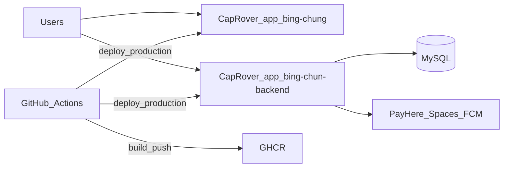

# 13 — Deployment Guide

## 1. Production topology (as implemented)



Verified CI constants (`.github/workflows/ci-cd.yml`):

| Item | Value |
|------|--------|
| CapRover URL | `https://captain.mp.dartcodes.com` |
| Backend app | `bing-chun-backend` |
| Frontend app | `bing-chung` |
| Backend public host (CI) | `https://bing-chung-b.mp.dartcodes.com` |
| Frontend API bake | `NEXT_PUBLIC_API_URL=/api` + `BACKEND_URL` / `API_PROXY_URL` → `https://bing-chung-b.mp.dartcodes.com` |
| Image registry | `ghcr.io/<owner>/bingchung/backend` and `.../frontend` |

Flutter apps are **not** deployed by this CI pipeline (store/sideload separately).

---

## 2. GitHub Actions CI/CD

Workflow: [`.github/workflows/ci-cd.yml`](../.github/workflows/ci-cd.yml)

**When it runs:** only after a merge (or push) onto the `production` branch. Other branches and PRs do not trigger this workflow.

**Stages:** `test` → `build` → `deploy`

| Job | When | Action |
|-----|------|--------|
| `test` | `production` only | Backend unit tests + delivery-service typecheck |
| `build-backend` | `production` only | Docker build `backend/Dockerfile` from repo root → GHCR |
| `build-frontend` | `production` only | Docker build `./Frontend` with `NEXT_PUBLIC_API_URL=/api`, `BACKEND_URL`, `API_PROXY_URL` → GHCR |
| `deploy-backend` | `production` only | CapRover deploy of the GHCR image via app token |
| `deploy-frontend` | `production` only | CapRover deploy of the GHCR image via app token |

Manual redeploy: Actions → CI/CD → Run workflow, and choose the `production` branch.

---

## 2.1 How to add CapRover tokens to GitHub

You need **two** secrets. Each CapRover app has its own token. Do not reuse one token for both apps.

| GitHub secret name | CapRover app |
|--------------------|--------------|
| `CAPROVER_BACKEND_TOKEN` | `bing-chun-backend` |
| `CAPROVER_FRONTEND_TOKEN` | `bing-chung` |

### A. Copy the token from CapRover

Repeat these steps once for **backend**, then again for **frontend**.

1. Open CapRover: [https://captain.mp.dartcodes.com](https://captain.mp.dartcodes.com) and sign in.
2. Click **Apps** in the left menu.
3. Open the app:
   - Backend → **bing-chun-backend**
   - Frontend → **bing-chung**
4. Open the **App Configs** tab (sometimes labelled **App Configs / Deployment**).
5. Find **App Token**.
   - If it is empty, enable or generate **App Token**, then save.
   - Click **Copy** (or select the whole token).
6. Keep this tab open until the GitHub secret is saved. You will not see the full token again if you leave and it is masked.

The token looks like a long hex string. It is **not** your CapRover login password.

### B. Paste the token into GitHub Actions secrets

You need **Admin** or **Maintain** access on the GitHub repo.

1. Open the GitHub repo: [https://github.com/DC-PVT-LTD/bingchung](https://github.com/DC-PVT-LTD/bingchung).
2. Click **Settings** (repo settings, not your profile settings).
   - If you do not see Settings, you do not have permission — ask an org owner.
3. In the left sidebar open **Environments**.
4. Open **bing-chun-backend** (not the empty `production` environment).
   - Click **Add secret**
   - **Name:** `CAPROVER_BACKEND_TOKEN` (exact spelling)
   - **Value:** CapRover app token for `bing-chun-backend`
5. Open **bing-chung**.
   - Click **Add secret**
   - **Name:** `CAPROVER_FRONTEND_TOKEN` (exact spelling)
   - **Value:** CapRover app token for `bing-chung`

GitHub only injects an environment secret into a job that uses that same environment name. Secrets on `bing-chun-backend` / `bing-chung` are ignored if the job uses `production`.

`CAPROVER_APP_TOKEN` also works on those two environments. Repository secrets (Settings → Secrets and variables → Actions) also work.

### C. One-time: let CapRover pull images from GitHub

GitHub builds images in GHCR. CapRover then **pulls** them. If `ghcr.io` is missing or the PAT is wrong, deploy fails with **Invalid credentials** even when the App Token is correct.

1. In CapRover go to **Cluster** → **Docker Registries**.
2. Click **Add Remote Registry**.
3. Fill in:

| Field | Value |
|-------|--------|
| Registry Domain | `ghcr.io` |
| Username | your GitHub username or the `DC-PVT-LTD` org |
| Password | a GitHub Personal Access Token with `read:packages` |

4. Create the PAT at [https://github.com/settings/tokens](https://github.com/settings/tokens) → **Generate new token (classic)** → enable **read:packages** → generate → copy once.

If the GitHub repo and packages are public, you can skip this registry step.

### D. Confirm it works

1. Merge a PR into `production` (or push to `production`).
2. On GitHub open **Actions** → **CI/CD**.
3. The run should show: Unit tests → Build backend/frontend → Deploy backend/frontend.
4. If deploy fails with a missing-secret error, the secret name is wrong or was not saved.

Do **not** commit tokens into the repo, `.env` files, or chat.

**Legacy:** [`.gitlab-ci.yml`](../.gitlab-ci.yml) still builds to GitLab Registry. Prefer GitHub Actions now that the repo is on GitHub.

**Path casing:** CI builds frontend from `./Frontend`. Linux runners fail if the folder is renamed to `frontend/`.

---

## 3. Docker

### Backend

- Multi-stage Node 22 Alpine
- `prisma generate` + `tsc`
- `docker-entrypoint.sh` waits for DB then `node dist/index.js`
- CapRover variant under `backend/deploy/`

### Frontend

- Next.js standalone output
- Build-arg `NEXT_PUBLIC_API_URL`
- Compose and CapRover Dockerfiles under `frontend/` and `frontend/deploy/`

### Local Compose production-like

```bash
docker compose up --build -d
```

Set strong JWT and DB passwords; configure public URLs.

---

## 4. NGINX

**NGINX configs in repository:** Not Implemented.

CapRover provides edge reverse proxy / routing for apps. Custom NGINX would be managed outside this repo (or CapRover nginx config UI) if required.

---

## 5. PM2

**PM2 ecosystem files in repository:** Not Implemented.

Process management in CapRover is container-based. For bare-metal Node without CapRover, operators would run `node dist/index.js` / `next start` under their own supervisor (PM2, systemd) — not documented as a first-class project path.

---

## 6. SSL and domain

SSL certificates and custom domains are configured in **CapRover** (Let's Encrypt typically), not in this repository.

Ensure:

- Frontend domain matches `FRONTEND_URL` / `NEXT_PUBLIC_SITE_URL`
- Backend domain matches `API_BASE_URL` and PayHere callback URLs (CI uses `bing-chung-b.mp.dartcodes.com`)
- Frontend production prefers same-origin `/api` proxied via `BACKEND_URL` / `API_PROXY_URL`
- CORS origins include production frontend/admin URLs

---

## 7. Reverse proxy

Handled by CapRover (or Compose published ports for local). No checked-in reverse-proxy templates.

---

## 8. Environment on CapRover

Set per app (backend):

- `DATABASE_URL`, `JWT_*`, `FRONTEND_URL`, `ADMIN_URL`, `API_BASE_URL`
- PayHere, Spaces, Firebase JSON, Maps, OAuth client IDs as needed

Frontend: rebuild when public API/socket URLs change (baked at build time).

---

## 9. Manual CapRover deploy scripts

Also available:

- `backend/deploy/deploy.sh`, `deploy-backend.ps1`
- `frontend/deploy/deploy.sh`, PowerShell helpers

These package `captain-definition` and call CapRover CLI.

---

## 10. Database in production

1. Provision MySQL 8
2. Apply schema (`db push` or ensure* on boot + SQL patches)
3. Run seed only for initial bootstrap (avoid re-seeding production casually)
4. Backups: see [23_Maintenance_Guide.md](23_Maintenance_Guide.md)

---

## 11. Mobile release notes

- Customer: always pass `--dart-define=API_BASE_URL=https://<prod-api>/api`
- Driver: verify default production URL or override
- Configure Firebase for Android; iOS FCM setup is incomplete in repo

---

## Related

- [22_Deployment_Checklist.md](22_Deployment_Checklist.md)
- [11_Environment_Configuration.md](11_Environment_Configuration.md)
