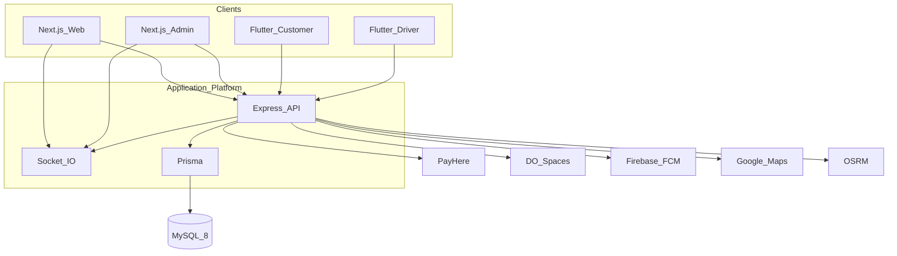
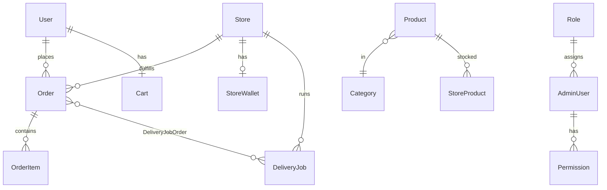
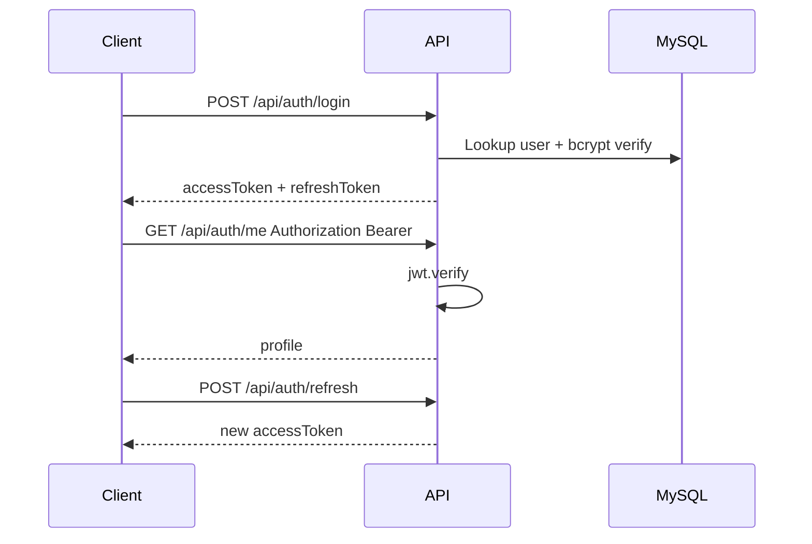
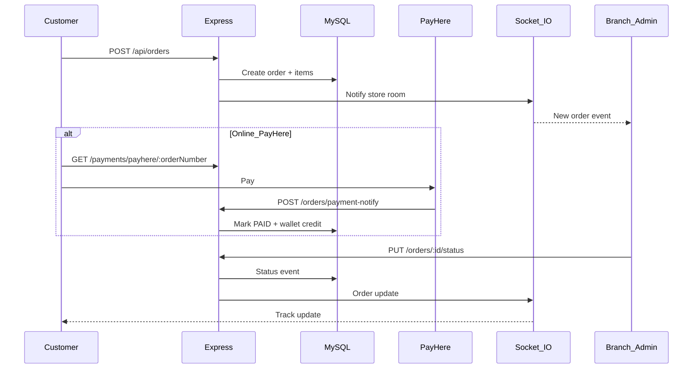
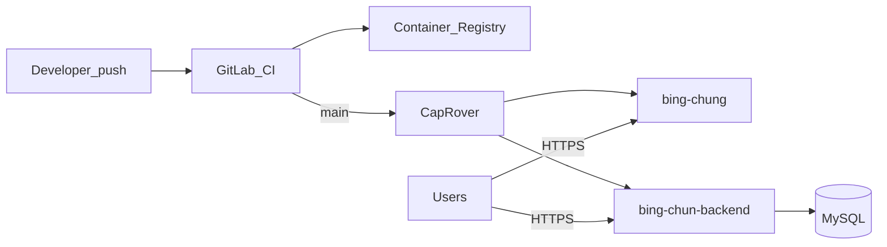
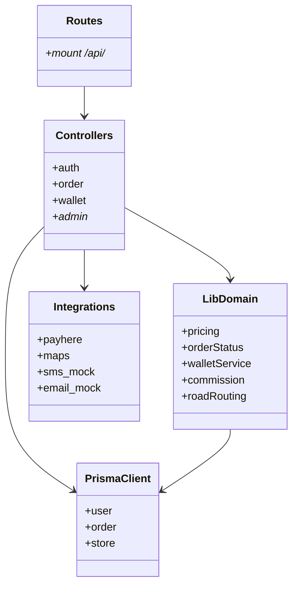

# 25 — Architecture Diagrams

Mermaid diagram pack for Bing Chun Online. Render in any Mermaid-compatible viewer (GitHub, GitLab, many IDEs).

---

## 1. System architecture

---

## 2. Database (core ER)

Full field documentation: [05_Database_Documentation.md](05_Database_Documentation.md).

---

## 3. Authentication sequence

Admin and delivery PIN flows are analogous with different endpoints and payloads.

---

## 4. API / order flow sequence

---

## 5. Deployment diagram

**NGINX/PM2 in repo:** Not Implemented — CapRover edge proxy used.

---

## 6. Class / module diagram (simplified)

**Repository classes:** Not Implemented.

---

## Related

- [02_System_Architecture.md](02_System_Architecture.md)
- [35_Shop_Pos_Admin_Architecture.md](35_Shop_Pos_Admin_Architecture.md) — shop, cashier, and admin process split
- [08_Authentication_Authorization.md](08_Authentication_Authorization.md)
- [13_Deployment_Guide.md](13_Deployment_Guide.md)
