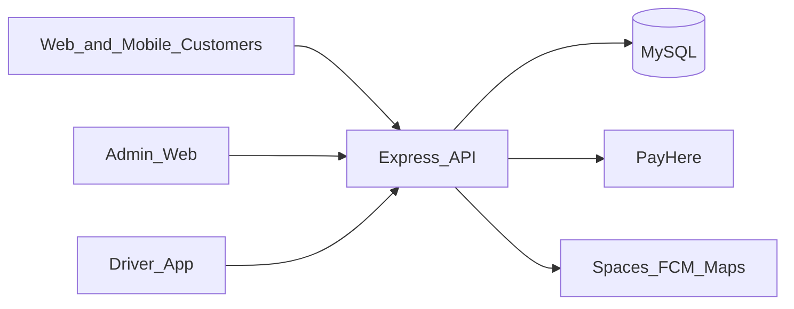

# 26 — Project Report

**Client-facing project report**  
**Product:** Bing Chun Online  
**Documentation date:** 2026-07-25  
**Versions:** Root/Backend `1.0.0` · Frontend `0.1.0` · Flutter apps `1.0.0+1`

---

## 1. Executive summary

Bing Chun Online is a production-oriented multi-channel ordering platform for Bing Chun beverage branches in Sri Lanka. Customers order for delivery or takeaway via a Next.js website and a Flutter customer app. Branch staff operate orders, stock, delivery batching, and settlements through a role-based admin panel. Drivers fulfill multi-stop routes using a dedicated Flutter app. The backend is an Express/Prisma API on MySQL with realtime Socket.io updates, PayHere payments, and CapRover deployment via GitLab CI.

The system delivers end-to-end digital commerce for franchise-style operations: catalog, fulfillment, payments, routing, and branch wallet/commission reconciliation.

---

## 2. Business problem

Branches previously lacked a unified digital stack for:

- Online ordering with correct branch and delivery-zone assignment
- Coordinated takeaway queues and delivery routes
- Online payments with cash fallbacks
- Transparent branch earnings, withdrawals, and platform commissions
- Role-appropriate access for cashiers, managers, and head-office admins

---

## 3. Solution delivered

| Capability | Delivered |
|------------|-----------|
| Customer web ordering | Yes (incl. account addresses, loyalty, notification prefs) |
| Customer mobile ordering | Yes (some secondary screens stubbed) |
| Admin operations panel | Yes |
| Driver mobile | Yes |
| PayHere online payments | Yes (mock when credentials missing) |
| Delivery job clustering + maps | Yes |
| Store wallets & settlements | Yes |
| RBAC + permission matrix | Yes |
| Realtime web tracking | Yes |
| Automated CI/CD to CapRover | Yes |

---

## 4. Users and roles

Customers (guest or registered), cashiers, store managers, system administrators, report viewers, and delivery drivers — as detailed in [01_Project_Overview.md](01_Project_Overview.md).

---

## 5. Architecture overview

Technical detail: [02_System_Architecture.md](02_System_Architecture.md), [25_Architecture_Diagrams.md](25_Architecture_Diagrams.md).

---

## 6. Technology stack (summary)

- **Backend:** Node.js, Express 5, TypeScript, Prisma, MySQL 8, Socket.io, Zod, Vitest  
- **Web:** Next.js 16, React 19, Zustand, TanStack Query, Tailwind 4  
- **Mobile:** Flutter + Riverpod (driver + customer)  
- **Deploy:** Docker, GitLab CI, CapRover  

Full list: [03_Technology_Stack.md](03_Technology_Stack.md).

---

## 7. Integrations

| Integration | Status |
|-------------|--------|
| PayHere | Implemented (+ mock fallback) |
| DigitalOcean Spaces | Implemented when configured |
| Firebase FCM | Implemented when service account configured |
| Google Maps | Implemented or mock |
| Google / Facebook login | Token verification Implemented |
| OSRM routing | Implemented |
| Dialog SMS | Not Implemented (mock default) |
| SendGrid email | Not Implemented (mock default) |

---

## 8. Testing posture

- Backend unit tests (Vitest) — auth, orders, analytics, wallets/settlements, pricing/payment, and related libs  
- Playwright E2E — login and order flows  
- Frontend unit tests — Not Implemented  
- Flutter tests — stubs only  
- CI does not run tests before deploy  

Recommendations: expand coverage and add a CI test gate.

---

## 9. Risks and gaps (transparent)

1. SMS/email production providers unfinished  
2. Interim web phone login without OTP  
3. Customer mobile API default points at a LAN IP unless overridden  
4. Hardcoded CORS LAN origins in Socket config  
5. Limited automated regression coverage for wallet/admin paths  
6. Horizontal scaling of Socket.io requires additional work (Redis adapter Not Implemented)  

Full list: [18_Known_Issues.md](18_Known_Issues.md).

---

## 10. Recommendations

| Priority | Recommendation |
|----------|----------------|
| High | Enforce production JWT secrets; fix customer mobile API default |
| High | Complete SMS/OTP path for production phone auth |
| High | Add CI test stage for unit + critical E2E |
| Medium | Formalize Prisma Migrate; reduce boot DDL |
| Medium | Centralize admin API client; add Next middleware for `/admin` |
| Low | Clean dead Flutter routes; refresh README accuracy |

---

## 11. Documentation delivered

Enterprise suite under `/docs` (documents 01–26) covering overview, architecture, database, APIs, business logic, security, deployment, testing, user/admin manuals, and this report. Index: [README.md](README.md).

---

## 12. Conclusion

Bing Chun Online provides a coherent, deployable platform for multi-branch beverage ordering, delivery operations, and financial settlement. Core commerce and operations flows are implemented and integrated with CapRover hosting. Remaining work is primarily production hardening (messaging providers, auth hardening, test automation, mobile release configuration) rather than greenfield feature invention.

---

*This report describes only capabilities verified in the repository. Items marked Not Implemented are absent or incomplete and should not be assumed present.*
