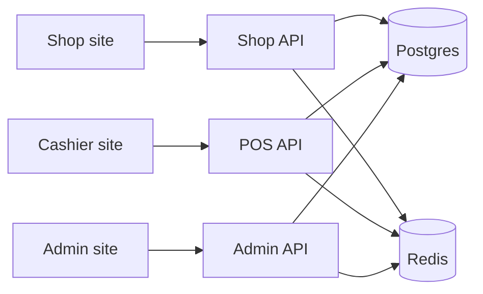

# 35 — Shop, cashier, and admin architecture

Customer checkout, the cashier, and admin run as separate processes from the same backend and the same Next.js app. They share one Postgres database and one login system. An admin outage does not stop checkout or the cashier once traffic has moved off `bing-chun-core`.

**Status:** Implemented in code. Live traffic stays on `bing-chun-core` until `DEPLOY_ROLE_SURFACES` and the API URL variables are set.  
**Decision:** [ADR 0007](adr/0007-shop-pos-admin-process-isolation.md)

This is process isolation, not three databases and not the unfinished orders, payments, or notification services under `services/`.

---

## 1. Runtime shape

| Process | `API_SURFACE` | CapRover app | What it serves |
|---------|---------------|--------------|----------------|
| Core | unset or `core` | `bing-chun-core` | Every current route. Production stays here until cutover. |
| Shop | `shop` | `bing-chun-shop` | Customer auth, menu, cart, checkout, payment callbacks, customer sockets |
| Cashier | `pos` | `bing-chun-pos` | Staff login, POS orders, order status, takeaway queue, collect-payment |
| Admin | `admin` | `bing-chun-admin` | Dashboard, stock writes, users, wallets, settings, reports |

| Web app | `WEB_SURFACE` | CapRover app | Host |
|---------|---------------|--------------|------|
| Shop | `shop` | `bing-chun` | `bingchunsrilanka.com` |
| Cashier | `pos` | `bing-chun-pos-web` | Its own hostname |
| Admin | `admin` | `bing-chun-admin-web` | Its own hostname |

One image is deployed three times. The env var picks the surface. `API_SURFACE` is not baked into the image.

---

## 2. What each API is allowed to mount

The allowlist lives in `backend/src/routes/surfaces.ts` and `backend/src/routes/surfacePolicy.ts`. The process refuses to boot if a forbidden prefix is mounted.

| Surface | Mounts | Refuses |
|---------|--------|---------|
| Shop | Customer `/auth`, menu read, stores, cart, customer order handlers, `/payments`, inventory reservations, public settings, promos, loyalty summary, spin, wishlist, notifications | `/admin`, `/refunds`, `/internal`, `/delivery` |
| POS | Staff login and refresh, menu read, `POST /orders` only when `channel` is `POS`, order status, takeaway queue, collect-payment, a narrow `/admin` slice for permissions, dashboard, and notifications | `/payments`, `/refunds`, stock writes, wallets, `/internal`, `/delivery` |
| Admin | `/admin/*`, staff auth, menu and store writes, orders (no payment notify), refunds, promos, settings, loyalty, spin | `/payments` and `POST /orders/payment-notify` |
| Core | The historical full router | Nothing extra |

A customer token is still rejected by `requireAdmin` on staff routes. A cashier token is still rejected by `requirePermission` and `blockCashier` on system-admin routes. The allowlist is the extra boundary so those handlers are not even mounted on the wrong process.

---

## 3. Shared data and realtime

All three processes use the same `DATABASE_URL` and `JWT_SECRET`.

- Customer tokens stay `Authorization: Bearer`.
- Staff tokens stay the httpOnly cookie `bc_admin_at` plus CSRF. Each staff site sets that cookie only for its own host.
- `COOKIE_DOMAIN` must not be the parent domain. Shop, POS, and admin refuse to boot if it is set, so an admin cookie is not sent to the shop.

Stock writes stay on one Postgres. `FOR UPDATE` and idempotent `deductOrderItemsOnce` already serialize two orders for the same product. Extra processes do not need a second database.

New-order alerts are emitted in the shop process and must reach cashier screens on the POS process. Socket.io uses the Redis adapter when `REDIS_URL` is set. In production, shop, POS, and admin refuse to start without Redis, and they refuse to start if the socket adapter is not Redis. Rate limits use the same Redis so the three processes do not keep separate counters.

Background jobs run on one process only:

- Reservation expiry, pickup reminders, schema patches, and the integration consumer run when `RUN_BACKGROUND_JOBS=true`.
- Default is on for shop and core, off for POS and admin.
- Schema patches on shop, POS, and admin also require `RUNTIME_SCHEMA_PATCHES`.

Each role process defaults to a Prisma pool of 4 connections so three pools plus core do not exhaust Postgres `max_connections`.

---

## 4. How the browser reaches an API

`Frontend/next.config.ts` builds rewrites at image build time.

- Unset `SHOP_API_URL`: the shop site still calls `bing-chun-core`.
- `SHOP_API_URL` set: `/api` and `/socket.io` go to the shop API. `/api/payments` and `/api/orders/payment-notify` stay on core during the overlap. `/api/admin` and `/api/auth/admin` go to `ADMIN_API_URL` or core, so the shop-hosted admin UI does not break before the admin host exists.
- `ADMIN_WEB_URL` set: `/admin` on the shop site proxies to the admin app. If that proxy is down, the shop pages still load.
- `WEB_SURFACE=pos` or `admin`: `Frontend/src/middleware.ts` keeps staff on `/admin` routes for that host.

Payment callbacks are accepted on both core and the shop API while both are up. Admin and POS never expose those URLs.

---

## 5. Rollout

New apps deploy only when the GitHub repository variable `DEPLOY_ROLE_SURFACES` is `true`. Until then the existing pipeline does not try to deploy apps that do not exist yet.

1. Deploy shop, POS, and admin APIs beside core. Point no browsers at them. Confirm `/health` shows `surface` of `shop`, `pos`, or `admin`.
2. Place a test order on the shop API and confirm a cashier socket on the POS API receives it.
3. Set `SHOP_API_URL` on the shop web build. Leave payment notify reachable on core and shop.
4. Deploy the cashier and admin web apps. Move staff to those hosts. Leave core `/api/admin` in place until those hosts are proven.
5. Only after all three serve real traffic, scale core down. Do not delete core routes in the same release that switches traffic.

Environment samples: `deploy/caprover-dev/bing-chun-shop.env`, `bing-chun-pos.env`, `bing-chun-admin.env`, `bing-chun-pos-web.env`, `bing-chun-admin-web.env`.

### CapRover API env (staff Accept / CSRF)

Cookie-authenticated `PUT`/`POST` from the admin or POS web apps send an `Origin` header for the **web** hostname. Set these on **`bing-chun-admin`**, **`bing-chun-pos`**, and **`bing-chun-core`** (if still serving staff routes):

| Variable | Example |
|----------|---------|
| `ADMIN_URL` | `https://bing-chun-admin-web.bc.dartcodes.com/admin` |
| `ADMIN_WEB_URL` | `https://bing-chun-admin-web.bc.dartcodes.com` |
| `POS_WEB_URL` | `https://bing-chun-pos-web.bc.dartcodes.com` |
| `FRONTEND_URL` / `LIVE_SHOP_URL` | Customer shop only (e.g. `https://bing-chun.bc.dartcodes.com`) |

Without `ADMIN_WEB_URL` / `POS_WEB_URL`, staff on dedicated hosts get **403 Origin not allowed** on order Accept. Quick unblock: `CORS_EXTRA_ORIGINS` with the same HTTPS origins, then restart the API app.

Health on a role process includes `surface`, `backgroundJobs`, `rateLimitStore`, and `socketAdapter`.

---

## 6. What this does not change

- Checkout, POS placement, stock deduction, and login behavior stay the same.
- Delivery stays on `delivery-service` and `bing-chun-delivery`.
- `services/orders`, `services/payment`, and `services/notification` are not part of this split.
