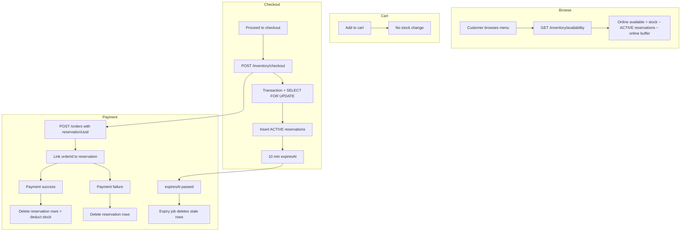

# Inventory Reservation System

Production-ready soft holds on `store_products.stock` during checkout. Physical stock is **never** reduced until payment succeeds. Online availability subtracts the per-product **out-of-stock buffer** (default 5 units) so counter walk-ins can still sell those units via FIFO batches.

## Architecture



## Data model

Table: `store_product_reservations`

| Column | Purpose |
|--------|---------|
| `reservationUuid` | Groups all line items from one checkout session |
| `storeId` + `productId` | Outlet-specific hold |
| `quantity` | Units reserved |
| `status` | `ACTIVE` while held; row is **deleted** on payment success, failure, or expiry |
| `expiresAt` | 10 minutes from checkout start |
| `orderId` | Set when order is placed |

**Formula**

```
Available Stock = store_products.stock − SUM(ACTIVE reservations for storeId+productId where expiresAt > NOW)
```

The `stock` column meaning is unchanged — it always reflects physical inventory.

## Sequence: concurrent checkout

```mermaid
sequenceDiagram
  participant U1 as User A
  participant U2 as User B
  participant API as Backend
  participant DB as store_products + reservations

  U1->>API: POST /inventory/checkout (qty 10)
  API->>DB: BEGIN; SELECT stock FOR UPDATE
  API->>DB: INSERT reservation ACTIVE
  API->>DB: COMMIT

  U2->>API: POST /inventory/checkout (qty 45)
  API->>DB: BEGIN; SELECT stock FOR UPDATE
  Note over API,DB: available = 50 − 10 = 40
  API-->>U2: 409 Insufficient stock

  U1->>API: Payment success
  API->>DB: status COMPLETED; stock -= 10
```

## REST API

Base path: `/api/inventory`

| Method | Path | Description |
|--------|------|-------------|
| `GET` | `/availability?storeId=&productId=` | Single SKU available stock |
| `GET` | `/availability/batch?storeId=&productIds=a,b` | Batch availability |
| `POST` | `/reservations` | Create reservation session |
| `POST` | `/checkout` | Alias for checkout reservation |
| `GET` | `/reservations/:uuid` | Status + countdown |
| `DELETE` | `/reservations/:uuid` | Cancel (release hold) |
| `POST` | `/reservations/payment-success` | Internal: complete + deduct |
| `POST` | `/reservations/payment-failure` | Release on failure |
| `POST` | `/reservations/expire` | Manual/cron expire sweep |

### Example: start checkout

```http
POST /api/inventory/checkout
Content-Type: application/json

{
  "storeId": "store-uuid",
  "items": [
    { "productId": "prod-uuid", "quantity": 2, "productName": "Milk Tea" }
  ]
}
```

Response:

```json
{
  "reservationUuid": "…",
  "expiresAt": "2026-08-05T10:10:00.000Z",
  "ttlMinutes": 10,
  "items": [{ "productId": "…", "quantity": 2 }]
}
```

Pass `reservationUuid` in `POST /orders` body when placing the order.

## Integration with existing code

| Event | Location | Behaviour |
|-------|----------|-----------|
| Browse | `GET /inventory/availability` | Read-only, no holds |
| Add to cart | Client / `cartStore` | No stock change |
| Checkout | `checkoutReservationService` | Creates reservations |
| Place order (online) | `orderController.placeOrder` | Links reservation → order |
| Payment success | `orderPlacement.finalizeOrderAfterOnlinePayment` | Delete reservation rows + `deductOrderItemsOnce` |
| Payment failure | `orderSchema.cancelOrderOnPaymentFailure` | Delete reservation rows |
| Expiry | `jobs/reservationExpiryJob.ts` | Every minute → delete stale rows |
| Cash / counter | `validateOrderStock` | Uses available stock incl. reservations |

## Concurrency

- MySQL `SELECT … FOR UPDATE` on `store_products` row inside a transaction
- Reservation insert only if `physicalStock − activeReservations ≥ requestedQty`
- Idempotent payment finalization via existing order status events + `deductOrderItemsOnce`

## Files

```
packages/db/prisma/migrations/20260805150000_store_product_reservations/
backend/src/lib/inventoryReservationSchema.ts
backend/src/repositories/inventoryReservationRepository.ts
backend/src/services/inventoryReservationService.ts
backend/src/services/checkoutReservationService.ts
backend/src/controllers/inventoryReservationController.ts
backend/src/routes/inventoryReservations.ts
backend/src/jobs/reservationExpiryJob.ts
docs/INVENTORY_RESERVATION.md
```

## Operations

1. Run migration: `npm run db:migrate`
2. Or rely on runtime patch: `ensureInventoryReservationSchema()` on boot
3. Set `FRONTEND_URL` and call `POST /inventory/checkout` before payment for best UX
4. Expiry job starts automatically with the API server

## Edge cases

| Case | Handling |
|------|----------|
| Two users, last item | Second checkout gets 409 after row lock |
| Payment timeout | Reservation expires; stock returns automatically |
| Browser closed | Same — expiry job releases hold |
| Refresh checkout | Pass `reservationUuid` + `renewExisting: true` |
| Admin stock edit | Physical `stock` changes; available recalculated on next lock |
| Duplicate payment callback | Existing idempotent deduct + reservation rows already deleted |
| Product disabled mid-checkout | Lock row sees `isAvailable = 0` → reject |
