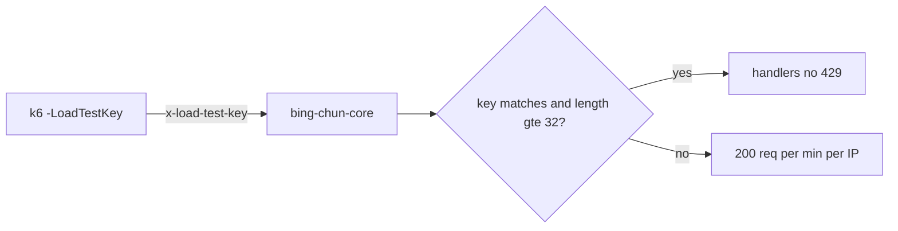

# Rate-limit bypass for full-scale load tests (Option A)

Production `bing-chun-core` enforces **200 requests per minute per IP** via Express
(`backend/src/middleware/rateLimiter.ts`). High-VU k6 runs from one machine hit that
ceiling quickly and return **HTTP 429** — you measure the limiter, not server capacity.

**Option A (recommended):** tag test traffic with a shared secret header. Real users
keep the normal limit; only requests with the correct `x-load-test-key` skip rate limits.

Do **not** raise or disable the global limiter for everyone (Option B) — that weakens
DDoS protection for all traffic during the test window.

## How it works



Implementation: [`backend/src/middleware/loadTestBypass.ts`](../../backend/src/middleware/loadTestBypass.ts)

- Fails closed when `LOAD_TEST_BYPASS_KEY` is unset or shorter than 32 characters
- Compares header with `crypto.timingSafeEqual`
- Wired into general, auth, OTP, and delivery-auth limiters on core
- k6 sends the header when you pass `-LoadTestKey` ([`load-tests/lib/env.js`](../lib/env.js))

Driver GPS tests hit **bing-chun-delivery** directly — the same bypass applies there
after the delivery-service change in this repo.

## Step 1 — Generate a key

```bash
openssl rand -hex 32
```

Example output: 64 hex characters. Store it in a password manager for the test window only.

## Step 2 — Set CapRover env vars (test window only)

1. Open [https://captain.bc.dartcodes.com](https://captain.bc.dartcodes.com)
2. **bing-chun-core** → App Configs → Environmental Variables
3. Add:
   ```
   LOAD_TEST_BYPASS_KEY=<your-64-char-hex-key>
   ```
4. Save (app restarts)

If running the **driver** scenario against production delivery:

5. **bing-chun-delivery** → same variable, **same key value**

Unset both when the test window ends.

## Step 3 — Run k6 with the same key

```powershell
# Browse-only production test (safe default)
.\load-tests\run.ps1 `
  -TargetEnv production `
  -Profile typical `
  -Scenarios browse `
  -ConfirmProduction `
  -LoadTestKey "<your-key>"

# Higher VU count
.\load-tests\run.ps1 `
  -TargetEnv production `
  -Scenarios browse `
  -ConfirmProduction `
  -LoadTestKey "<your-key>" `
  -Vus 100 `
  -Duration 5m `
  -ThinkTimeMs 3000

# Driver GPS (also set key on bing-chun-delivery)
.\load-tests\run.ps1 `
  -TargetEnv production `
  -Scenarios driver `
  -ConfirmProduction `
  -LoadTestKey "<your-key>" `
  -DriverToken "<jwt>"
```

## Step 4 — Verify bypass before a long run

**With header (should NOT 429 under heavy repeat):**

```powershell
$key = "<your-key>"
$headers = @{ "x-load-test-key" = $key; Accept = "application/json" }
1..250 | ForEach-Object {
  Invoke-WebRequest -Uri "https://bing-chun-core.bc.dartcodes.com/api/stores" `
    -Headers $headers -UseBasicParsing | Out-Null
}
Write-Host "OK — 250 requests with bypass key"
```

**Without header (should 429 after ~200 in one minute):**

```powershell
# Run quickly; expect 429s once over 200/min
1..250 | ForEach-Object {
  try {
    Invoke-WebRequest -Uri "https://bing-chun-core.bc.dartcodes.com/api/stores" `
      -UseBasicParsing -TimeoutSec 5 | Out-Null
  } catch {
    if ($_.Exception.Response.StatusCode -eq 429) { Write-Host "429 at request $_"; break }
  }
}
```

## Step 5 — Post-test cleanup (required)

1. Remove `LOAD_TEST_BYPASS_KEY` from **bing-chun-core** (and **bing-chun-delivery** if set)
2. Save / redeploy so apps restart without the key
3. Confirm limiter works again — repeat the “without header” check above; 429s should return
4. Archive reports from `load-tests/reports/` and share findings with the team

Never leave the bypass key in CapRover permanently.

## Full-scale (30,000 VU) checklist

Before targeting 30k VUs on production:

- [ ] Same scenario tested on localhost/staging at increasing VUs (`load-tests/ladder.ps1`)
- [ ] Bypass key set on core (+ delivery if needed) and passed via `-LoadTestKey`
- [ ] Team notified; off-peak test window agreed
- [ ] Production scenario is **browse-only** unless explicitly approved (`order` writes DB rows)
- [ ] Server monitoring ready (CPU, RAM, DB connections on CapRover / Postgres)
- [ ] Cleanup plan: unset keys immediately after the run

### Client machine limits

A single Windows load generator cannot honestly sustain 30,000 concurrent connections:

- Ephemeral TCP ports: ~14k default (widen with admin: `netsh int ipv4 set dynamicport tcp start=10000 num=55000`)
- CPU / RAM on the test machine becomes the bottleneck before the server

Use [`load-tests/ladder.ps1`](../ladder.ps1) to find the real ceiling, then scale out with
[k6 distributed execution](https://grafana.com/docs/k6/latest/testing-guides/running-distributed-tests/)
if you need more than one machine can generate.

## Options we do not use

| Option | Why not |
|--------|---------|
| B — Raise/disable limiter globally | Unprotects real users and abuse traffic for the whole test window |
| C — IP allowlist | Fragile for distributed tests; harder to audit than a tagged header |

## Related docs

- [production-browse-smoke.md](production-browse-smoke.md) — what the browse scenario hits
- [../README.md](../README.md) — profiles, scenarios, reports
